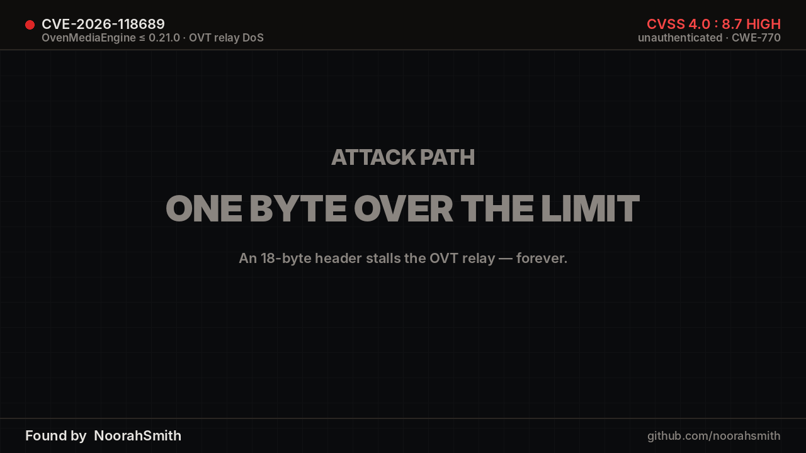

Summary of the Issue:
The OvenMediaEngine OVT relay (the Origin→Edge transport, plaintext and TLS on port 9001) can be stalled indefinitely by a single 18-byte packet header. When an OVT header declares a `payload_length` above the valid maximum of 32750, `OvtPacket::LoadHeader()` has already committed `_payload_type` to the packet object before the bounds check runs. The check then fails and returns, but the half-initialised object makes `IsHeaderAvailable()` report true, so `OvtDepacketizer::ParsePacket()` treats the rejected packet as merely "incomplete" and waits for more data instead of closing the connection. Any unauthenticated client that can reach the OVT listener can hold connections open and grow server buffers without limit. Tracked as CVE-2026-118689 (CVSS 4.0: 8.7, High; CWE-770), affecting version 0.21.0 and earlier.

Key Findings:
Zero Authentication: The flaw is in packet framing, before any OVT message is processed, so no credentials or handshake are required.
State Committed Before Validation: `SetPayloadType()` runs before the `payload_length` bounds check, leaving `_payload_type` non-zero on a rejected packet while `_payload_length` stays 0.
Rejected Looks Like Incomplete: `Load()` returns the same `false` for "need more data" and "invalid", and the depacketizer tells them apart only by `IsHeaderAvailable()`, which the partial state has already poisoned.
Silent Hold-Open: The connection is kept, not closed. The only relevant log line is at trace level (off by default), so a stalled session leaves no clear trace in default configuration.
Unbounded Buffer Growth: Bytes are only drained from `_packet_buffer` after a successful parse, which never happens, so anything the attacker keeps sending accumulates with no cap (CWE-770).
Network Exposure: Both the plaintext and TLS OVT listeners (port 9001) are affected; one small header pins each connection.

Impact:
This is an availability attack with a very low cost to the attacker. A single 18-byte header per connection ties up an OVT relay slot and leaves buffered memory growing. A short flood of such headers can exhaust relay capacity and disrupt Origin→Edge stream delivery for live viewers, while the server logs nothing obvious to point operators at the cause. There is no impact to confidentiality or integrity — the bug is a control-flow failure after a rejected header, not a memory-safety issue (and not the buffer overflow claimed in Discussion #1990, which could not be reproduced).



Technical Details:

Affected code is at tag v0.21.0, in `src/modules/ovt_packetizer/`. Two design issues combine: `LoadHeader()` writes header fields (including `_payload_type`) before it validates `payload_length`, and `Load()` returns the same `false` for both "not enough bytes yet" and "invalid packet". The caller disambiguates with `IsHeaderAvailable()`, which only checks `_payload_type > 0` — a field the partial write has already set.

Call path and attack flow:



Related functions:



Protocol constants (`ovt_packet.h`):

```c
#define OVT_FIXED_HEADER_SIZE          18
#define OVT_DEFAULT_MAX_PACKET_SIZE    32768
// max valid payload = 32768 - 18 = 32750
```

`payload_length` is a 16-bit field at header offset 16, so the wire format carries 0–65535 but the implementation accepts only ≤ 32750. Every value from 32751 to 65535 is invalid and reaches the faulty path.

The partial commit — `OvtPacket::LoadHeader()`:

```cpp
// Read header
SetMarker(buffer[0] & 0x20);
SetPayloadType(ByteReader<uint8_t>::ReadBigEndian(&buffer[1]));       // (1) state committed
SetSequenceNumber(ByteReader<uint16_t>::ReadBigEndian(&buffer[2]));
SetTimestamp(ByteReader<uint64_t>::ReadBigEndian(&buffer[4]));
SetSessionId(ByteReader<uint32_t>::ReadBigEndian(&buffer[12]));

uint16_t payload_length = ByteReader<uint16_t>::ReadBigEndian(&buffer[16]);
if (payload_length > OVT_DEFAULT_MAX_PACKET_SIZE - OVT_FIXED_HEADER_SIZE)  // (2) validated after
{
    loge("ERROR", "Invalid payload length : %u", payload_length);
    _is_packet_available = false;
    return false;                                                    // (3) _payload_type still set
}
SetPayloadLength(payload_length);                                    // never reached -> stays 0
```

On return at (3) the object holds `_payload_type` = attacker-chosen non-zero, `_payload_length` = 0. The earlier `version != OVT_VERSION` check is safe because it runs before any `Set*()`; only the length check comes after the state is written.

The misclassification — `OvtDepacketizer::ParsePacket()`:

```cpp
if (packet_mold->Load(*_packet_buffer) == false)
{
    if (packet_mold->IsHeaderAvailable())     // true, because _payload_type > 0
    {
        logtt("Buffer is not enough ...");    // trace level, off by default
        return true;                          // keep the connection, wait for more
    }
    else
    {
        logte("Packet is invalid ...");
        return false;                         // the branch that SHOULD run: close
    }
}
```

The invalid packet takes the "not enough data yet" branch and the session is kept. It never recovers: bytes are only drained from `_packet_buffer` after a successful `Load()`, so the poisoned 18-byte header stays at offset 0 permanently, every subsequent read re-parses it to the same result, and each parse also reserves a fresh 32 KB packet buffer before failing. Anything the attacker keeps sending accumulates without limit.

Trigger conditions:
Network: reach the OVT listener (plaintext or TLS, e.g. 9001).
Authentication: none — the flaw is in framing, before any OVT message.
version bits: must equal 1 (otherwise rejected safely earlier).
payload_type: any non-zero value (with 0, `IsHeaderAvailable()` is false and the connection closes correctly).
payload_length: 32751–65535.
Cost per connection: 18 bytes, a single header.

Execution flow:

```
Attacker                         OvenMediaEngine (OVT listener)
  | 18-byte header               |
  | ver=1, type!=0, len=32751 -> | AppendPacket() -> _packet_buffer = [hdr]
  |                              | ParsePacket() -> Load() -> LoadHeader()
  |                              |   SetPayloadType(type)       _payload_type != 0
  |                              |   len > 32750 -> return false _payload_length = 0
  |                              |   IsHeaderAvailable() -> true
  |                              |   "Buffer is not enough" -> return true  (session kept)
  | more bytes (optional) -----> | buffer grows, same header re-parsed forever
  v                              v
 connection slot + buffer memory held until the attacker disconnects
```

Proposed fix — validate before committing any header state:

```diff
--- a/src/modules/ovt_packetizer/ovt_packet.cpp
+++ b/src/modules/ovt_packetizer/ovt_packet.cpp
@@ bool OvtPacket::LoadHeader(const ov::Data &data)
+	// Validate before committing any header state
+	uint16_t payload_length = ByteReader<uint16_t>::ReadBigEndian(&buffer[16]);
+	if (payload_length > OVT_DEFAULT_MAX_PACKET_SIZE - OVT_FIXED_HEADER_SIZE)
+	{
+		loge("ERROR", "Invalid payload length : %u", payload_length);
+		_is_packet_available = false;
+		return false;
+	}
+
 	// Read header
 	SetMarker(buffer[0] & 0x20);
 	SetPayloadType(ByteReader<uint8_t>::ReadBigEndian(&buffer[1]));
 	SetSequenceNumber(ByteReader<uint16_t>::ReadBigEndian(&buffer[2]));
 	SetTimestamp(ByteReader<uint64_t>::ReadBigEndian(&buffer[4]));
 	SetSessionId(ByteReader<uint32_t>::ReadBigEndian(&buffer[12]));
-
-	uint16_t payload_length = ByteReader<uint16_t>::ReadBigEndian(&buffer[16]);
-	if (payload_length > OVT_DEFAULT_MAX_PACKET_SIZE - OVT_FIXED_HEADER_SIZE)
-	{
-		loge("ERROR", "Invalid payload length : %u", payload_length);
-		_is_packet_available = false;
-		return false;
-	}
 	SetPayloadLength(payload_length);
```

With `payload_length` validated first, `_payload_type` stays 0 on invalid input, `IsHeaderAvailable()` returns false, and `ParsePacket()` takes the existing "Packet is invalid" branch that closes the connection.

Given the High Severity of this issue, specifically the potential for a full Origin→Edge relay outage from unauthenticated traffic, I recommend the following immediate actions:
Validate `payload_length` before any `Set*()` call in `LoadHeader()`, so a rejected header leaves `_payload_type` at 0 and the depacketizer closes the connection.
Return a tri-state parse result (Ok / NeedMoreData / Invalid) instead of overloading `false`, and bound `_packet_buffer` so an incomplete packet cannot grow without limit.
Restrict the OVT listeners (plaintext and TLS 9001) to known Edge server IPs via firewall rules or security groups, and add idle/handshake timeouts in front of the relay.


---

*Found by NoorahSmith · github.com/noorahsmith · Reported in [issue #2330](https://github.com/OvenMediaLabs/OvenMediaEngine/issues/2330), assigned via VulnCheck.*
